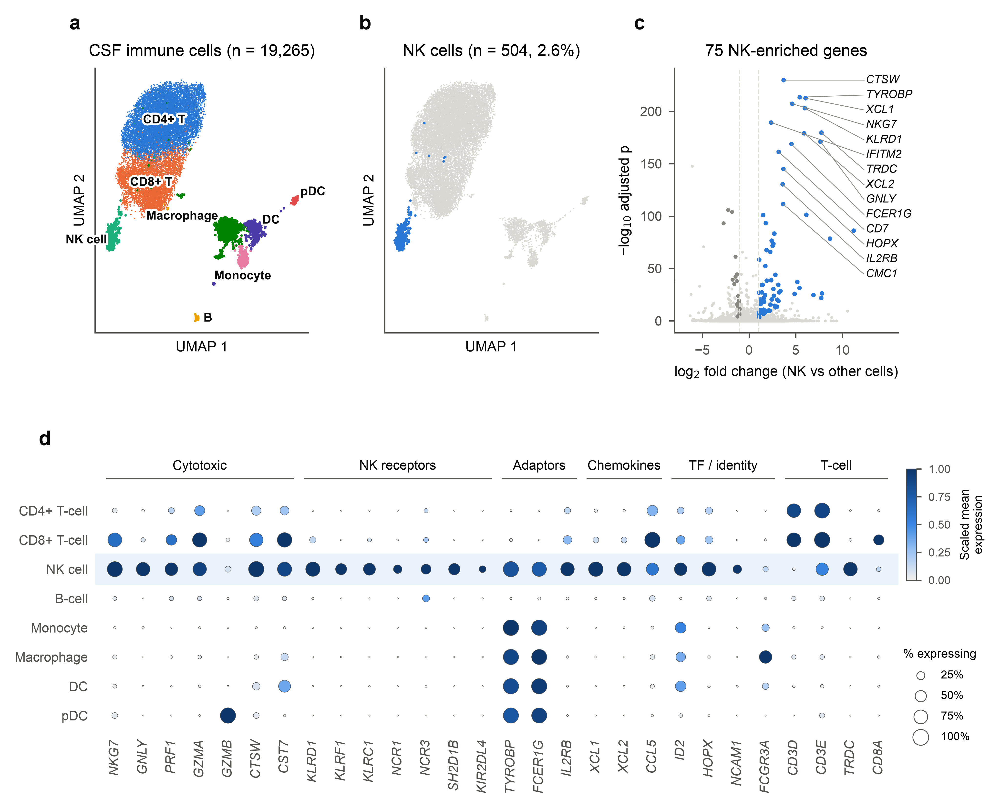
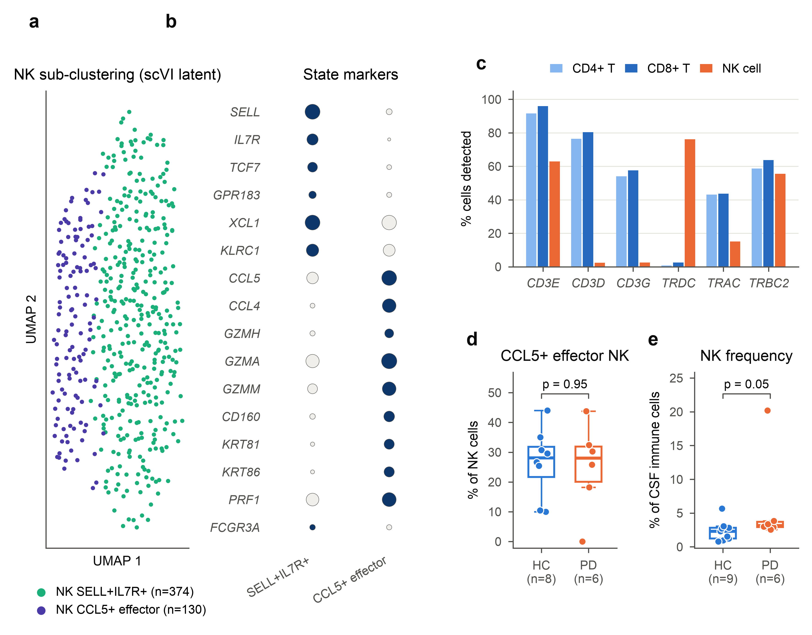
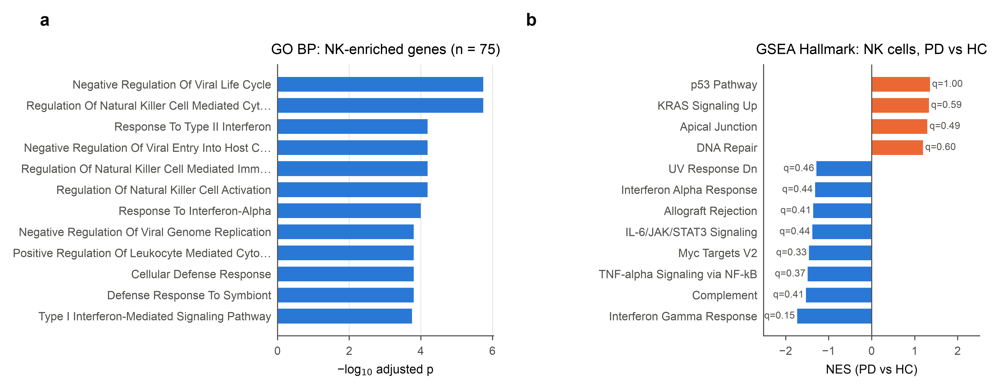
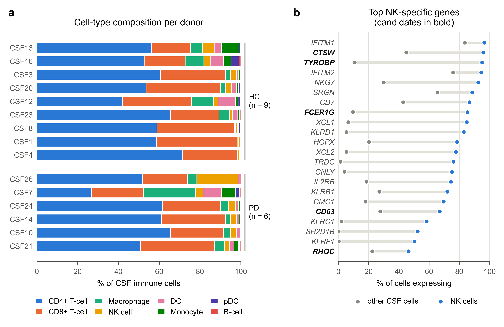

# NK cells in Parkinson's disease CSF: candidate genes for α-synuclein clearance

Single-cell RNA-seq of public PD cerebrospinal fluid · Python / scanpy / scVI · [short report](PD_CSF_NK/report/NK_CSF_report.md)

## Why
In Parkinson's disease (PD), dopamine neurons in the substantia nigra die while misfolded α-synuclein accumulates.
In mice, natural killer (NK) cells take up and degrade α-synuclein, and removing NK cells makes the pathology worse
(Earls et al., *PNAS* 2020), and NK cells have been reported to expand in PD CSF (Guan et al., 2022). That makes CSF a
place to look for the genes they use for this. I wanted a short list of NK genes that could later be measured in CSF from Bangladeshi
PD patients.

## Data
Public 10x Genomics CSF scRNA-seq, GEO [GSE141578](https://www.ncbi.nlm.nih.gov/geo/query/acc.cgi?acc=GSE141578)
(Gate et al., *Science* 2021). Sixteen CSF samples were processed (19,265 cells). The PD vs healthy-control (HC) comparisons
use 6 PD and 9 HC donors; one Lewy body dementia donor was left out of those comparisons.

## What I did
1. QC, doublet and low-quality cell removal, scVI integration across donors, Leiden clustering, marker-based annotation
   → `PD_CSF_NK/code/01_qc_integration_annotation.ipynb`
2. Picked out the NK cells, found the genes enriched in them (against all other cells and against CD8⁺ T cells, the closest
   neighbouring population), then sub-clustered NK states and ran GO enrichment
   → `PD_CSF_NK/code/02_nk_target_genes.py`, `PD_CSF_NK/code/03_nk_figures.py`
3. Short-listed candidate genes for qRT-PCR and plotted cell-type composition per donor
   → `PD_CSF_NK/results/candidate_genes.csv`, `PD_CSF_NK/code/04_overview_figure.py`

## Results

**1. NK cells in CSF.** 504 of 19,265 CSF immune cells (2.6%) were NK cells. They express 75 NK-enriched genes, and
58 of these are also higher than in CD8⁺ T cells.



**2. Two NK states.** The NK cells fall into a SELL⁺IL7R⁺ state (CD56^bright-like, n = 374) and a CCL5⁺ cytotoxic effector state (n = 130).



**3. Pathways.** The NK-enriched genes are dominated by NK cytotoxicity, interferon response and antiviral defence.



**4. Candidate genes.** Every candidate is NK-enriched (adjusted p < 0.05, log2FC > 1, expressed in more than 25% of NK
cells, higher than in CD8⁺ T cells) and has a plausible link to uptake, migration or degradation.

| Gene | % NK vs other cells | Why it is a candidate |
|---|---|---|
| *TYROBP* (DAP12) | 95% vs 11% | adaptor of the TREM2–TYROBP phagocytic axis |
| *FCER1G* | 85% vs 10% | Fc-receptor adaptor, a possible route for uptake of antibody-bound α-synuclein |
| *CD63* | 67% vs 28% | late endosome/lysosome marker, the pathway NK cells use to degrade α-synuclein |
| *CTSW* | 96% vs 45% | lymphocyte-restricted cathepsin and the top NK gene in CSF |
| *RHOC* | 46% vs 22% | Rho-family GTPase (RAC1 family) involved in migration and engulfment |



*(a) CSF is dominated by CD4⁺ and CD8⁺ T cells in every donor, and NK cells are a small but consistent fraction.
(b) The candidates (bold) are expressed in most NK cells and in far fewer other CSF cells.*

The links to α-synuclein come from the literature and are hypotheses. They have not been tested here.

## Limitations
- This is a small public cohort (6 PD and 9 HC donors with NK cells; 7–55 NK cells per donor). At donor level no NK gene
  differed between PD and HC after multiple-testing correction, so the candidates are **NK-specific**, not yet
  **PD-specific**.
- This is RNA from one dataset. It needs validation in an independent cohort and at the protein level.

## Next step (proposed, not funded)
qRT-PCR of these genes in paired blood and CSF from PD patients in Bangladesh, in collaboration with the National
Institute of Neurosciences & Hospital (NINS), Dhaka. The full plan is in `PD_CSF_NK/proposal/Neuroprotective_Cells_PD_Proposal.docx`.
Sample access was agreed, but funding was not secured.

## Repository
Everything for this project is in [`PD_CSF_NK/`](PD_CSF_NK/):
```
code/       01 notebook (QC → scVI → annotation), 02 NK genes, 03 NK figures, 04 overview figure
figures/    PNG + PDF
results/    candidate_genes.csv, NK marker tables, GO enrichment, NK states, composition
report/     short written report
proposal/   validation proposal (qRT-PCR, NINS)
```
To run: `pip install -r requirements.txt`, download GSE141578, run the notebook (edit the input path in it), and move the
`combined.h5ad` and `integrated.h5ad` files it writes into `PD_CSF_NK/data/`. Then run `python PD_CSF_NK/code/02_nk_target_genes.py`, `python PD_CSF_NK/code/03_nk_figures.py` and `python PD_CSF_NK/code/04_overview_figure.py`.

### Other folders
- `code/`, `figure/`: an earlier general scRNA-seq pipeline in R/Seurat (QC, clustering, annotation, trajectory,
  differential expression, enrichment)
- `parkinson disease/`: first exploratory runs on GSE141578 (scanpy notebook, Seurat script)

## References
- Earls RH et al. NK cells clear α-synuclein and the depletion of NK cells exacerbates synuclein pathology in a mouse model of α-synucleinopathy. *PNAS* 2020.
- Gate D et al. CD4⁺ T cells contribute to neurodegeneration in Lewy body dementia. *Science* 2021;374:868–874.
- Guan L et al. Single-cell RNA sequencing of CSF reveals neuroprotective RAC1⁺ NK cells in Parkinson's disease. *Front Immunol* 2022;13:992505.

## License
MIT
